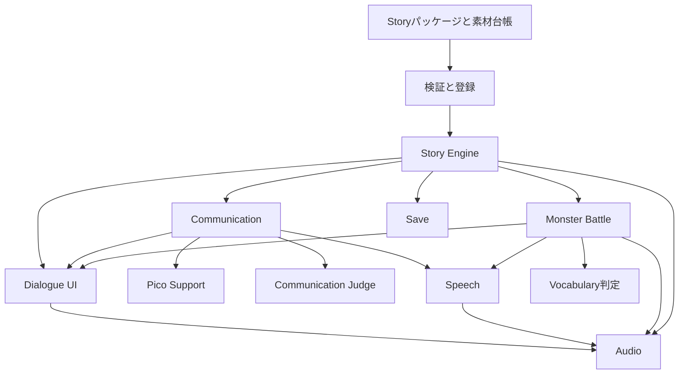

# Eigo DE Quest 共通エンジン再構築 Phase 1

2026年11月24日（JST） · 独立設計レビュー候補

基準は `kwgkw452-collab/Quest` の Production `s005-fixed-195-stage-clean-test`、コミット `70706cfa8dd7efd404b1fb45ef2ec9254e82ca4f`。承認済みのゲーム仕様・素材と固定コミットの観測結果を移行の比較基準に使う。両者が食い違う場合は差分を記録し、仕様決定者の裁定を得る。Phase 1の成果は設計と検証計画。

## 1. 構成図

矢印は呼び出しまたはデータ提供を表す。各画面フローは利用するポートを起動時に受け取る。実行時の依存はStory IDやグローバル変数から解決しない。エンジンが読めるStoryデータは検証済みの宣言だけとする。CommunicationとMonster Battleは発話入出力を共有し、問いの意味判定と語彙の照合は別の契約を持つ。

## 2. 責任と入出力

| モジュール | 入力 | 出力・責任 |
|---|---|---|
| 検証と登録 | バージョン付きパッケージ、素材台帳、共通の機能カタログ | 検証済みの不変データか、パス付きエラー。登録一覧から起動対象を解決 |
| Story Engine | Story参照、既存Save、セッションの取消シグナル | ステップを実行し、完了・冒険へ戻る・中断/障害を返す。分岐、場面遷移、Save反映を管理 |
| Communication | 課題定義、選択済み出題、発話とUIのポート | Goal、認識結果、再挑戦、次への進行を管理。受理時のみ結果をStoryへ返す |
| Speech | ユーザー操作から開始する一試行、言語、試行ID、取消 | 候補列と確定・無音・権限拒否・取消などの状態。認識の終了処理を一元化。ブラウザ固有の差はアダプターに収める |
| Judge | 問題別の規則、認識候補、対話文脈 | ACCEPT／REJECT／UNKNOWN、内部の理由コード。純粋なローカル判定を標準とし、承認対象に限り同じ契約で外部プロバイダーを選択 |
| Pico Support | 問題別の3段階ヒント、問題セッションの現在段階 | 段階1→2→3→3の日本語表示データ。再挑戦は同一段階を保持し、次問で0 |
| Dialogue UI | 話者、本文、Goal、認識・ヒント・状態、許可された操作、レイアウト | 表示とユーザー操作イベント。通常台詞・発話課題・手紙を同じ表示基盤で描画。認識・採点・進行を所有しない |
| Audio | BGM・SE・Voiceのキュー、ブラウザの操作制約、発話用の利用権とミックス設定 | 再生ハンドルと完了/停止/再生不可の結果。出力と音量を所有し、再生可否でゲーム進行を止めない |
| Monster Battle | モンスター定義、語彙セット、進行演出、終了条件 | 既存の語彙バトルを進め、完了・戻るを返す。画像切替・撃破/浄化/友好的な終了は承認済み定義で指定 |
| Save | 互換キー、進行イベント、明示的な状態更新 | 既存セーブの読み取りと確定イベントの一度だけの記録。失敗・取消時の未確定更新を防ぐ |

セッションの所有者はStory Engine、発話試行の所有者はCommunicationまたはBattle、マイクの所有者はSpeech、音量復帰の所有者はAudio。再試行時にAttempt IDを更新し、旧試行の遅延通知を破棄する。Speechはマイク解放後にAudioへ利用権を返す。Audioはその利用権ごとに一度だけ復帰し、後続の利用権を巻き戻さない。端末依存の開始・解放待機は再現テストで根拠が確認できた経路だけを採用する。

## 3. Storyデータ共通仕様 v1（設計契約）

### パッケージ

一話につき `story.json` と参照素材を用意する。分割ファイルへの展開はローダーの責任とし、ロード結果は下の形に統一する。話ごとの登録情報はデータカタログに置き、起動側はそのカタログから解決する。

| フィールド | 型と制約 |
|---|---|
| schemaVersion / id / title / entry | 必須。v1では整数1、カタログ内で一意のID、表示名、開始シーン参照 |
| sceneOrder / scenes | シーンID配列とID→定義の辞書。開始から遷移可能であること。シーン内stepsは順序付き |
| assets / cast | 素材ID→種別・相対URL、話者ID→表示名。共通カタログ参照も可。主人公視点の描画条件はシーン定義に記述 |
| challenges / pools / rules | 課題、抽選候補、意味判定の辞書。使用する範囲で必須。未承認の候補をProduction用データとして登録しない |
| documents / battles | 手紙やモンスターの定義参照。利用するステップがある場合に必須 |
| saveKeys | 更新を許す互換キーと値型。加入、完了等の永続化を明記 |

### ステップと参照

| type | 必須の内容・動作 |
|---|---|
| scene / clear | sceneは背景参照と表示領域。clearは場面に残る一時描画を終了 |
| line | 話者（ナレーションはnull）と表示本文。任意の日本語補助・Voice参照・進行ポリシー |
| challenge | 課題ID。結果を次のステップまたは許可済みの戻り先へ接続 |
| document | 手紙などの参照。カード画像、文の配列、各言語、行別Voice、許可済み操作の組を定義 |
| battle | モンスター参照と完了/戻りの遷移先。語彙・段階・Endingはモンスターデータが所有 |
| setFlag / goto / end / hideDialogue | 宣言済みキーと型付き値、行き先参照、終了結果、会話欄を隠す操作 |

課題は `goalJa`、`modelEn`、規則参照、抽選参照（固定出題なら省略可）、日本語ヒント3段、受理後の遷移を持つ。規則は目的・対象・必要条件・許容表現・明示除外を型付き演算子で記述する。正規化と認識誤りの救済は適用範囲を明示する。模範文と許容表現は別フィールド。対応できない規則は影響のある受理/拒否例を添えてレビューし、任意の式やStory専用の実行コードには変換しない。抽選の再現用seedは実行側から注入し、再試行は同じ出題を維持する。

画面配置はシーンごとに `frame`（素材の表示領域、通常/ヒント表示時のアンカーとオフセット）を持てる。UI状態は `dialogue`、`communication`、`hintExpanded`、`document` として表示モデルで渡す。素材URLの文字列による暗黙の判定を共通CSSから除く。数値の移行では元の表示を画面比較で再現する。

V1ローダーは未知のフィールド/ステップ、重複ID、参照切れ、許可外の素材URL、未宣言のSave更新、実行結果の行き先欠落をロード時に拒否する。シーンへの到達不能と入力待ちのない循環は静的検証対象。ユーザー操作待ちを含む再挑戦はフローとして許可する。教材パッケージにJavaScript、任意HTML/CSS、コールバックを含めない。素材のハッシュは移行時の機械照合に用いる。

### 同じ形式への割り当て

| 既存Story | 共通形式で保護する体験 |
|---|---|
| S005 | sequenceを順序付きstepsに展開。ホテルとベンの場面、台詞・Voice・現行質問ID・背景・会話欄の表示順を移す。固定HEADには質問呼び出しが12件あり、引き継ぎ上の11問と差がある。実際の到達経路と承認原本を確認し、裁定まで増減しない |
| S006 | 13枚の背景、10課題、通常2行とピコ説明時の拡張、背景の見切れ防止をsceneのframeで表現。専用Ending命令はdocumentへ移し、カード、手紙単位の言語切替、Voiceと終了操作を保存。PR #11の候補差分は承認・統合状態を照合して扱う |
| S007 | 13 Sceneと10課題を同じ型に収める。Scene 12の加入で `setFlag` により `s007.megJoined = true`、Scene 13で旅立つ。加入前後と再読み込み時の状態を証拠に残す |

## 4. 現行コードの整理計画

| 判定 | 基準コミット内の対象 | 移行時の処置と確認 |
|---|---|---|
| 再利用 | `data/s005-communication.js`、`data/s006-communication.js`、`data/s007-communication.js`、素材、`data/s006-ending.js` | 承認済みのGoal、台詞、模範、ヒント、判定、素材をデータへ変換。全文・順序・素材ハッシュ・判定コーパスを照合 |
| 再利用 | `data/audio-mix-profile.js`、`data/audio.js`、`save-manager.js` のキーと形式、既存Judgeの純粋な正規化/判定処理 | 発話ダック0.25／300ms、復帰600ms、会話Voice用の別プロファイルを基準とする。再利用候補は既存テストと実機の成功経路で確認 |
| 書き換え | `story-engine.js`、`story-compiler.js`、`story-registry.js`、StoryのJS登録と専用onExit | 任意JS実行を型付きステップへ移す。取消とリソース解放を共通ライフサイクルへ集約 |
| 書き換え | `audio-manager.js`（約3,879行） | 出力ドライバ、ミックス、セッション制御に責任を絞る。台詞Voice・BGM・SEの成功経路、ジェスチャー起動、発話前後の音量を先に固定。監視やラップ関数は機能依存を検証して撤去 |
| 統合 | `question-manager.js`、`communicative-question-flow-controller.js`、`communication-task-progress-controller.js`、Judge gateway/adapters | 本番到達経路ごとの入出力を確認し、発話試行・採点・再試行の所有者を一つにする。未使用と断定する前に通常起動とdevの両方を確認 |
| 統合 | `dialog-manager.js`、2つのCommunication presenter、`s006-ending-controller.js`、関連CSS、`pico-support-controller.js` | 共通の表示モデルと部品に移す。Goal常時表示、承認済みの復帰ボタン、Ending固有の操作を画面テストに固定 |
| 統合 | `monster-battle-manager.js`、presenter、battle-data、既存モンスター設定 | 既存語彙・重複答え・復帰・段階切替と終了演出を維持。既存の進行画像指定を共通データ契約に取り込む。Story課題とは判定を共有しない |
| 削除 | Flowの `/^s006\.communication\./`、`dialogue-information.css` の `images/006/S006-Scene-` 条件、専用 `s006EndingLetter` 命令 | 意味のある汎用状態とレイアウト値へ移行し、代替経路と同等性を確認した移行単位で削除 |
| 削除候補 | `legacy-speech-trace.js`、AudioManager内のunlock/identity/loud-graph診断と本番入口の関連設定 | 観測専用条件を本番から撤去。実際に動作を支える処理が混在する場合は小さな出力ポートへ移す。テストで必要な観測は試験側の限定イベントに置く |

例示パスは `engine/core/`、`engine/controllers/`、`engine/managers/`、`engine/presenters/`、`engine/services/`、`data/`、`css/` にある。移行で置き換え済みの入口は同じ変更単位で切り替え、参照閉包を確認して旧コードを除去する。互換層を要するなら旧Save形式など対象・所有者・撤去条件をレビューで明示する。

## 5. 移行順序とリスク

1. **比較基準を固定**。対象SHA、承認済み原本、既知の実機成功経路、素材台帳、データと発話の期待値を記録。S005の質問数差とS006の承認済み修正の適用先を決着させる。
2. **移行ブランチで縦に通す**。Phase 2承認後、合成パッケージを公開入口と同等の経路で起動し、ロード→台詞→発話課題→復帰→終了→Saveを通す。途中のデータ形式・UI・Audio契約の齟齬を調整する。
3. **既存データ移行**。S005〜S007を同一フォーマットで移し、手紙、加入、二行/三行表示を比較したのち、S001〜S004、関連Morning/Camp・Saki離脱、既存Monsterへ順次適用する。承認されたVoiceと素材を変換元と照合。
4. **入口切替・不要経路撤去**。index/dev、通常ルートと直接起動を検証。各経路の移行ごとに旧呼び出しを除去し、旧アプリと新アプリの比較は固定SHAの別ビルドで実施。
5. **独立QAと統合承認**。差分、固定SHA、実機結果、旧Saveとの互換を提出。独立QAが判定し、新庄先生が統合を承認する。切戻しは承認済み前版の成果物へ戻す。Save互換が確認できるまでは書き戻しで旧版が読めない形式へ更新しない。

| リスク | 判定と対策 |
|---|---|
| 切替時の認識結果/音量復帰の競合 | 成功・無音・取消・遅延通知・連続再試行を強制し、試行ごとに音量復帰1回、次の台詞の初回再生を確認 |
| 採点の許容範囲が変わる | 正解、許容する認識揺れ、別対象、誤答を独立期待値で固定。旧版との違いは承認済み変更に紐付ける |
| 特殊演出の消失と素材の見切れ | S006手紙とS007加入を専用受入ケースにし、素材ハッシュと実画面を確認 |
| 既存Save・進行の破損 | 既存Saveスナップショットからの継続、取消・再読込、繰り返し完了を確認 |
| 既存処理が残留しStory追加ごとに分岐が増える | 共通コード・CSSでStory固有ID/素材パスを検査し、独立作成の追加Storyで編集範囲を実測 |

## 6. レビューと受入基準

| 区分 | 必須証拠・判定 |
|---|---|
| Phase 1 独立設計レビュー | 8領域の所有権と接点、3話のデータ変換可能性、現行動作の移行対応、整理対象、旧Save互換、テストの実施可能性を確認。未裁定の仕様と前提を記録し、実装対象の承認へ進む |
| 自動・データ | スキーマと参照整合、教材・素材の比較、壊れたパッケージ拒否、決定的な抽選、100パッケージ相当の登録と任意話の起動で固定長やID依存がないことを確認 |
| 自動・実行 | Storyの順序/分岐、認識成功・無音・権限拒否・取消・遅延イベント、判定コーパス、Goal、承認済み3操作、ヒント1→2→3→3と次問0、文字入力への切替なし、敗退からの冒険復帰を検証 |
| 自動・ブラウザ | index/devと通常導線で既存話を起動。S006の2/3行と手紙、S007加入、既存Battleの語彙と終端、Save再読込、実背景の表示を確認。Speechは注入したブラウザ境界で制御し、実機承認と分ける |
| iPhone実機 | 端末・iOS・ブラウザ・SHAを記録。初回タップ、BGM/SE/Voice、初回発話と連続再挑戦、戻る操作、復帰後最初の再生と音量、横長の会話欄と見切れ、手紙操作、既存Battleの成功経路を現行版と比較。既知症状がある場合は再現条件と差分を記録し、原因追跡をこの仕事の条件にしない |
| 独立QA | 候補と基準のSHAを記録し、候補ブランチの実装から独立に用意した承認済み期待値で再検証。未承認の期待値や実機未検証はHOLD。承認仕様違反や新たな回帰はFAIL |
| 新話追加の最終試験 | 独立QAが先に未登録だったStoryパッケージを作成し、許可する差分をStoryデータ・素材・データカタログと追加話用テストに限定。機能カタログや実行コード・CSSのGit blobが一致することを確認し、通常入口から台詞→Communication→戻る/完了→次の進行→Save再読込を実行。既存ケースも再実行する |

Phase 1では上の試験や実機確認は未実施。100話への対応は、実装後の追加Story試験、全既存体験の回帰試験、登録規模の試験結果を揃えて判断する。
