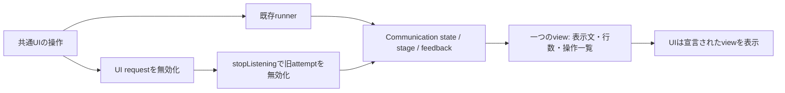

# Pico Support V2 限定整理

対象Issue57、PR56原本6e579f36ab3cc609428da1a27719fc65088fc384。独立QA原本509de4dfb85e1d1501edfc95c60326f5062f92f8。再監査／全面書換えではなくPICO01〜04の修正。

## 責務と不変条件

- `communication.cjs:view()`がnormal/listening/support/feedback、表示文字、layoutMode、actionsを確定。unified.jsは聞こえた文字列の正規表現・hint有無・独自listening引数で行数を再判定しない。
- 通常108px二行、Support／feedback140px三行、Goal白・Support黄色・左揃え・横一列ボタンは維持。聞き取り中もstop/support/returnをEngineが宣言する。既にSupportが開いているときは聞き取り中も140pxを維持。
- SupportはfeedbackとrecognizedTextを消して1→2→3→3。文言はq.hintsをそのまま使う。新問はrunner既存の新Communication作成で0に戻る。
- 台詞Supportは既存paintDialogueLine内の英文／日本語切替のまま。Communicationの段階数を共有しない。
- `sessionEpoch`（Story切替）、`speechRequest`（UI操作世代）、runner `serial`（冒険へ戻る）、Communication `attempt/active`（非同期試行）、recognizer `seq/live`（ブラウザ認識寿命）は異なる責務なので維持。

## 指摘別修正

- PICO01：support()がfeedbackを解消。旧認識結果がヒントを覆わない。
- PICO02：UIのheard/help/listening分岐とspeechBusyを削除。Engineのviewと既存Question/Battle stateに従う。view.actionsを共通ハンドラで描画する。
- PICO03：三行gridをGoal:auto／Support:minmax(0,1fr)／actions:autoにして余白をヒントへ配分。旧32px上限と冗長な三行Goal上書きを削除。フォント・ヒント本文・140px外形は変更しない。
- PICO04：Judge catchで現行attemptと照合してからstateを更新。旧例外・旧解決はstale、現行例外は従来どおりthrowしてREADYに戻す。UIのstale描画は正常画面を消さずログのみ。

## 削除・保持

削除：未読dialogueVoiceとそのnull代入、無意味なnativeRecognizer別名、存在しないrecognizer.stop分岐、UI speechBusy、paintQuestionの独自状態判定、重複twoRow設定、質問描画前の重複clearButtons、stale結果の上書き画面、旧Support高さ上限・冗長CSS。

保持：fit-content(55%)と二列のsecondary。これはSupport専用ではなく文書／冒険に戻る／未Supportの聞き取り表示にも使われるため、監査指示に従い残した。Story/Graphic/ヒント/承認LOCK/共通Judge/Save/Battle/recognizerの実装・仕様は変更しない。runnerも変更不要のため既存のまま。bundleは正規buildで生成。

## テスト期待値の移設

既存runtime.test.cjsの「誤答feedbackはtwoRow」という旧期待値は、Issue57で明示された三行140pxへ修正。旧プレイヤーの既存Chromium検査も、同じfeedbackの108px期待値1箇所だけ140pxへ修正した。正誤・表示文・Graphic配置の期待値は維持。承認済み32問のparity期待値・LOCK JSONは変更していない。prefix文字列のソース検査は、責務移動に合わせてUIではなくEngineを検査するよう移設し、UIがEngine表示文を使うことも検査。これらは不具合を隠す緩和ではなくPICO02の修正に必要な契約更新。

QAのcheck.py/targeted.pyにあるSave cursor・模擬recognizer・geometryの再現経路を128ケースの回帰テストへ引き継いだ。独立スクリプト原本は出典SHAで保存・再取得可能。Nodeのcheck.cjsも固定PR7と後続承認データを読み込んで再実行する。実行環境のブラウザパス／HTTP portだけは一時adapterで差し替える。

## 未完了の検収

制作側のNode/Chromium/CI成功は独立QA最終PASSではない。物理iPhoneのSpeechRecognition／可読性／Safe Area、独立QAによる正式再検収はHOLD。S005〜S007にBattle定義はないため、Monsterは既存共通fixtureの複数語進行・失敗・Return回帰で検査し、実戦全体の独立認定は主張しない。
